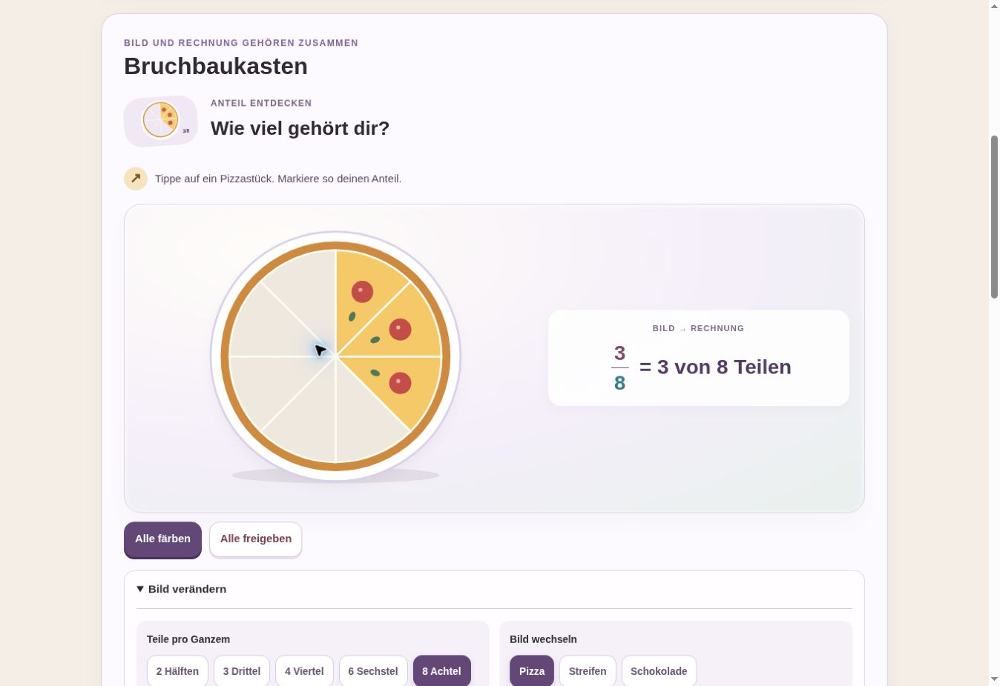

# Mathe-Merkheft · Klasse 6

## Aktueller Aufbau – 29.10.2026

Die neun Themen verwenden denselben geführten Kursaufbau wie das Englisch-Merkheft: Lernen, Beispiele, Bildwerkzeug, Nachschlagen. Unter Lernen führt ein nummerierter Grundlagenpfad durch drei bis fünf passende Musterwege. Im Beispiel bleibt die Aufgabe sichtbar; pro Schritt erscheinen genau das passende Bild und eine Rechenzeile. Antwort und vollständige Heftrechnung erscheinen erst am Ende.

Die 98 Beispiele sind vollständig in `course-data.js` enthalten und pro Kapitel nach Grundlagen, Aufbau und anspruchsvolleren Varianten geordnet. `course.js` steuert den einzigen sichtbaren Beispielbereich, `course.css` gestaltet ihn. Die alten überlagerten Seitentransformationen aus `einfach.js` und die alte Seitennavigation aus `merkheft.js` werden von den Themenseiten nicht mehr geladen. Die nativen Bildwerkzeuge bleiben im Bereich Bildwerkzeug erhalten. `rechenbilder.js` erstellt das zum aktuellen Datenstand passende Bild; Voransichten zeigen keine gesuchten Ergebnisse.

Validierung: 98 Beispiele im tatsächlichen Browser von der Voransicht bis zur Antwort durchlaufen; alle neun Kapitel in Handybreite auch mit Bildwerkzeug und Nachschlagen geprüft. Automatische Prüfung von 383 Bildzuständen, Mengen- und Flächenerhaltung sowie gezielten Fällen gegen vorgezogene Ergebnisse (8/20, 28 Kinder, negative Mitte). Direkte Feldzählung und Würfelnetz ebenfalls bedient.

Die nachfolgenden älteren Änderungsnotizen beschreiben die Entwicklung vor diesem Kursaufbau.


Interaktives Merkheft zu Brüchen, rationalen Zahlen und Dezimalzahlen. Neun Kapitel, 98 unterschiedliche Musterwege und neun Bildwerkzeuge. Keine separate Übungseinheit, keine Punkte und keine Antwortbewertung.

Einstieg: `index.html`. Veröffentlichung über das bestehende GitHub Pages auf `main`.

## Aufbau

- Grundidee in kurzen, strukturierten Aussagen
- Bildwerkzeug zum Verändern, Vergleichen, Bündeln und Vergrößern
- Eine sichtbare Aufgabenkarte je Kapitel; Vorheriger/Nächster Musterweg oben und unten
- Geschlossene Auswahl mit Suche und direktem Sprung zu allen Aufgabentypen
- Direkte Links und Browser-Zurück wählen die richtige Karte; geöffnete Schritte bleiben beim Blättern erhalten
- Im Ausdruck bleiben alle Musterwege enthalten
- Je Musterweg: Denkstütze, begründete Einzelschritte, verdeckte Heftrechnung, Kontrolle, Denkfalle, Übertragung
- Gemeinsame Grundgestaltung und Navigation: `merkheft.css` und `merkheft.js`; Bildfolgen und Verknüpfungen: `bildlabor.css` und `bildlabor.js`

Alle aktuellen Kapitel verwenden diese vier gemeinsamen Dateien. `style.css` und `lernwerkzeuge.js` bleiben als nicht eingebundene Altdateien erhalten.

Buchabgleich, Umfang und Grenzen: [buchabgleich.md](buchabgleich.md).

## Prüfung am 29.10.2026

- Alle neun Kapitel im Chromium-Browser geladen; Modelle und Bedienelemente vorhanden.
- 18 Darstellungs-/Auswahlzustände der Werkzeuge durchgeschaltet.
- Suche, Aufgaben-Navigator, einzelne Aufdeckschritte, vollständige Heftrechnung und Zurücksetzen geprüft.
- Viele Ganze: 30 Hälften als 15 vollständige Gruppen ohne Abschneiden dargestellt.
- Größenmodell und Rückumrechnung einschließlich periodischer Zeitwerte geprüft; gerundete Werte mit ≈ gekennzeichnet.
- Alle Kapitel bei 375 CSS-Pixeln Inhaltsbreite ohne horizontalen Überlauf geprüft. Zusätzlich eine geöffnete Erklärung samt Musterweg in der schmalen Vorschau kontrolliert. Kein Test auf einem physischen Smartphone.
- JavaScript-Syntax, lokale Links, eindeutige IDs und Musterwegstruktur geprüft.

Keine externen Bibliotheken, Schriften oder Trackingdienste erforderlich.

## Weiterentwicklung des Bildlabors · 29.10.2026

Die neun Bildwerkzeuge bestehen nun aus steuerbaren Bildfolgen mit vier Schritten, Zurück/Vorwärts und einem Wechsel auf eine verwandte Aufgabenstellung. Animationen laufen ausschließlich bei einem angeforderten Schritt; die Systemeinstellung für reduzierte Bewegung wird berücksichtigt.

- Teil–Ganzes: bekannte Gruppen, ein Teil, fehlende Gruppen ergänzen
- Kürzen/Erweitern: Schnittlinien verändern, gefärbte Fläche beibehalten
- Gemischte Zahlen: Stücke in vollständige Gruppen bewegen, Rest markieren
- Division: gleich große Pizzastücke auf Kinderteller bewegen
- Vergleich: zwei gleich große Skalen gemeinsam unterteilen
- Zahlenstrahl: verbundener Überblick und zwei aufeinanderfolgende Vergrößerungen
- Dezimalzahlen: Hundertstel in Zehnergruppen bündeln, Stellenwerttafel ergänzen
- Dezimalvergleich: erste unterschiedliche Stelle und Lage am Zahlenstrahl verbinden
- Größen: Länge, Fläche und Raum aufbauen; Würfelhülle als Netz auffalten; Menge gesondert von der Bezugseinheit darstellen

Bei dazu passenden Musterwegen wird ein Bild mit den aufgedeckten Rechenschritten weitergeschaltet. Die Bilder verwenden die Zahlen des jeweiligen Beispiels; komplexe Aufgaben ohne passenden dynamischen Modelltyp behalten ihre eigenständige Erklärung. Verwandte Aufgaben sind über ihre gemeinsame mathematische Struktur verlinkt. Alle 96 Musterwege bleiben erhalten. Es entsteht keine eigene Übungseinheit.

Prüfung: Vorwärtsfolgen aller Hauptmodelle im Browser, Zurücksetzen, Aufgabenwechsel und Wiederherstellung, Kopplung einer mehrstufigen Kürzung und einer Rückwärtsaufgabe. Alle neun Kapitel bei 375 CSS-Pixeln Inhaltsbreite ohne horizontalen Überlauf; Würfelnetz und Pizzaverteilung zusätzlich im schmalen Browser geprüft. Kein Test auf einem physischen Smartphone.

Mathematische Modellprüfungen ausführen:

```sh
node tests/bildlabor.test.cjs
```

Die Prüfungen decken u. a. 36 Modellzustände, unveränderte Flächen beim Kürzen/Erweitern, unveränderte Stückzahlen beim Bündeln, 20 Verteilungskombinationen, verschachtelte Vergrößerung und Einheitenumrechnungen ab. Dazu JavaScript-Syntax und lokale Ressourcenverweise geprüft.

## Sprache und Gliederung · 29.10.2026

- Alle 96 Aufgabenstellungen als getrennte Aufgabenzeilen.
- Schwierige Erklärungen in kürzere, begründete Einzelschritte zerlegt.
- Begriffe in jedem Kapitel über „Wörter einfach erklärt“ nachschlagbar.
- Hinweise im Bildlabor, beim Aufgabenwechsel und bei Strukturverweisen als einzelne Punkte.
- Zusätzliche Zwischenschritte beim Kürzen großer Zahlen und beim Finden eines gemeinsamen Nenners.
- Alle 96 Musterwege, Aufdeckschritte und mathematischen Bildfunktionen bleiben erhalten.

Prüfung: Ressourcenverweise, eindeutige IDs, 96 vollständige Musterwege und fehlende Absatzblöcke; bestehende Modelltests erfolgreich. Aufdeckfunktion und Sprache im Browser sowie Aufgabenzeilen und Wörterhilfe bei 375 Pixeln Inhaltsbreite geprüft.

## Umsetzung der acht ursprünglichen Werkzeugideen

Die acht Themen der Vorlage besitzen nun direkt bedienbare Hauptwerkzeuge. Die geführten Bildfolgen bleiben jeweils unter „Ein Beispiel Schritt für Schritt verstehen“ erreichbar. Das zusätzliche Kapitel „Brüche als Division“ behält seine eigene Verteilungs-Bildfolge.

| Werkzeug | Direkte Handlung |
|---|---|
| Bruchbaukasten | Einzelne Kreisteile, Streifenteile oder Felder färben/entfärben; Bild bei gleichem Anteil wechseln |
| Bruch-Werkstatt | Schnittlinien erzeugen, gleich große Teilstücke wieder zusammenfassen; unveränderte Fläche und Umformungsverlauf sehen |
| Bündelmaschine | Bruchstücke tatsächlich in Schachteln ziehen; alternativ auswählen und ablegen; vollständige Ganze und Rest erkennen |
| Gleichnamig-Labor | Beide Brüche unabhängig unterteilen und passende Stückgrößen finden |
| Verschiebbare Zahlenlinie | Punkt direkt ziehen oder mit Pfeiltasten bewegen; Ausschnitt verschieben und vergrößern |
| Stellenwert-Maschine | Hundertstel und Zehntel in Zehner-Bündler ziehen oder antippen; Zehnertausch und erhaltene Gesamtmenge sehen |
| Stellenwert-Lupe | Lupe ziehen oder Spalte antippen; die ausgewählte Ziffer bildlich vergrößern; spätere Stellen von der ersten entscheidenden Stelle unterscheiden |
| Räumliches Einheiten-Labor | Würfel direkt drehen; Füllung und markierte Schicht verändern; Hülle auffalten; Längen- und Flächenstücke direkt markieren |

Bildmodelle und direkte Bedienung: `anfasslabor.js` / `anfasslabor.css`. Die 96 Musterwege und Wörterhilfen bleiben erhalten. Keine Antwortbewertung und keine eigene Übungseinheit.

### Prüfung

```sh
node tests/anfasslabor.test.cjs
node tests/bildlabor.test.cjs
```

- Kürzen/Erweitern: Wertgleichheit für verschiedene Zähler, Nenner und Faktoren.
- Bündeln: Stückerhaltung und volle/teilweise Gruppen.
- Stellenwerte: Zehnertausch für alle Ausgangsmengen von 1 bis 199 Hundertsteln.
- Zahlenlinie: Einrasten auf die gewählte Bruchteilung.
- Würfel: endliche Projektion und sichtbare Eckpunkte für alle einstellbaren Drehwinkel.
- Browser: direkte Farbwahl und Bildwechsel, Unterteilen/Zusammenfassen, echtes Ziehen eines Stücks in eine Schachtel, wiederholtes Füllen, Zehnertausch, unabhängige Vergleichsteilung, Lupenauswahl und Tastaturbewegung.
- Browser: Bruchpunkt mit der Maus verschoben; Würfel mit der Maus gedreht; Füllung und Netz umgeschaltet.
- Alle acht direkten Werkzeuge bei 375 CSS-Pixeln Inhaltsbreite ohne horizontalen Überlauf. Direkte Farbwahl, Flächenwahl und Würfelnetz zusätzlich in der schmalen Vorschau bedient.
- Geführte Bildfolge nach Umbau weiterhin bedienbar.

Für Touch-Bedienung besitzen die Ziehaktionen gleichwertige Auswahl-/Ablege- bzw. Tippaktionen. Kein Test auf einem physischen Android-Gerät.

## Ruhige Aufgabenansicht

- Alle neun Kapitel zeigen im Browser genau einen Musterweg.
- Vorheriger/Nächster Musterweg stehen oberhalb und unterhalb der Karte.
- Die geschlossene Auswahl enthält Suche und direkten Sprung zu jedem Aufgabentyp.
- Suche mit und ohne Treffer, Suchreset, erster/letzter Musterweg und Browser-Zurück geprüft.
- Geöffnete Schritte bleiben beim Blättern erhalten; direkte Fragmentlinks öffnen die richtige Karte.
- Schmale Vorschau mit 375 CSS-Pixeln: Auswahl, Blättern und geöffnete Erklärung ohne horizontalen Überlauf.
- Alle 96 Musterwege und ihre Verlinkungen statisch geprüft; beide bestehenden Mathematiktests bestehen.
- Druckansicht enthält weiterhin alle Musterwege.

## Bildwerkzeuge mit eigener Bildsprache

- Pizza und Schokoladentafel als direkt markierbare, mathematisch gleich große Teile.
- Modelle stehen vor den Einstellungen; Bild und Rechnung teilen sich eine Arbeitsfläche.
- Häufige Einstellungen sind direkt sichtbare Auswahltasten statt Dropdowns.
- Bruchstücke mit Kreisbild, freie Schachtelplätze und Hervorhebung voller Ganzer.
- Stellenwert-Plättchen mit Mengenbildern, Zehner-Bündler und kurzen Transferbewegungen.
- Echte Lupenform, vergrößerte Ziffern, farblich getrennte Mengenbilder.
- Eigene Werkzeugbilder auf der Startseite in `werkzeugbilder.js`; genaue Modelle bleiben SVG/HTML.
- Ausführliche Begründung und Bedienhilfe in eigenen Aufklappbereichen.
- Bewegung nur als kurze Handlungsrückmeldung; reduzierte Bewegung wird respektiert.
- Alle neun Kapitel bei 375 CSS-Pixeln ohne horizontalen Überlauf geprüft.
- Markieren, Auswahlwechsel, Bündeln, Kürzen/Erweitern, gemeinsame Nenner, Zahlenstrahl per Tastatur, Lupenstelle, Würfelnetz und Flächengitter im Browser geprüft.
- 96 Musterwege bleiben erhalten; entfernte kapitelübergreifende Themenlisten bleiben entfernt.



## Klare Aufgaben und Farbsystem

- Keine Themenlisten und keine Verweise auf andere Kapitel innerhalb der Themenseiten.
- Die Startseite bleibt über den Merkheft-Titel erreichbar.
- Fehlende Arbeitsaufträge ergänzt; unklare Einheiten und Fragen präzisiert.
- Ein Gedanke pro Stichpunkt, mehr Abstand zwischen Angaben und Rechenschritten.
- Regeln: lila; Erklärungen: blau; Merksätze: gelb; jeweils auch durch Überschriften erkennbar.
- Alle 96 Musterwege, ihre Aufdeckschritte und die interaktiven Bildwerkzeuge bleiben erhalten.
- Alle neun Seiten statisch geprüft; Aufgabenkarte und geöffnete Erklärung in der schmalen Browseransicht kontrolliert.
- Mathematiktests für Bildlabor und direkt bedienbare Werkzeuge bestehen.

## Kürzen und Erweitern vereinfacht

- Die Regel steht vor den Fachwörtern: oben und unten mal dieselbe Zahl; beim Kürzen durch dieselbe Zahl teilen.
- Alle acht Musterwege sprachlich vereinfacht, Zahlen und Aufgabenfamilien erhalten.
- Werkzeug mit getrenntem Erweitern/Kürzen, Zahlen 2–5 und einem Vorher-nachher-Vergleich.
- Kein wiederholtes Anwachsen der Stückzahl bei weiteren Klicks.
- Zwei getrennte Rechnungen für Zähler und Nenner, gleicher gefärbter Anteil in beiden Streifen.
- Erweitern und Kürzen für alle vier Zahlen, Zurücksetzen, Aufdeckschritte und Auswahl im Browser geprüft.
- Mobile Darstellung bei 375 CSS-Pixeln ohne horizontalen Überlauf geprüft.

## Sprachprüfung und vollständige Antworten

- Alle 96 Musterwege enthalten einen eigenen Antwortblock im aufdeckbaren Heftbereich.
- Antworten nennen Ergebnis, nötige Einheiten und sämtliche gefragten Teilantworten.
- Alle 96 Denkfallen nennen einen konkreten Fehler und den richtigen Weg.
- Die Kürzungsprüfung bei 3/4 wird mit den Rechnungen 3 : 2 und 4 : 3 erklärt.
- Zähler und Nenner werden in den Kapitelglossaren mit Beispielen erklärt.
- Unklare oder verkürzte Aussagen wurden durch konkrete Rechenschritte ersetzt.
- Statisch geprüft: Antwortblöcke bleiben bis zum letzten Schritt verdeckt, 96 Musterwege erhalten, keine Textabsätze, keine Themenlisten, eindeutige IDs.
- Bestehende Mathematiktests bestanden.
- Erneute Browser-Sichtprüfung dieser Textfassung wegen Zeitüberschreitung des Browserdienstes nicht abgeschlossen; frühere Sichtprüfungen beziehen sich auf die vorige Fassung.

## Beispiele zuerst

- Jedes Kapitel beginnt mit drei auswählbaren Kurzbeispielen; jeweils eines ist sichtbar.
- Die Kurzbeispiele zeigen konkrete Zahlen, zwei bis drei Rechenschritte, eine Antwort und einen Merksatz.
- Es sind Kurzfassungen bestehender Musterwege, keine neue Übungseinheit.
- Die längeren Regeln stehen im geschlossenen Bereich „Regeln nachlesen“.
- Jeder Kurzweg führt direkt zum passenden ausführlichen Musterweg.
- Alle 96 ausführlichen Musterwege und vollständigen Antworten bleiben erhalten.
- Statische Prüfung: 27 Kurzbeispiele, korrekte Sprungziele und eindeutige IDs; JavaScript-Syntax und beide Mathematiktests bestanden.
- Browser-Sichtprüfung dieser Fassung weiterhin offen, nachdem der Browserdienst bei den vorherigen Versuchen nicht antwortete.

## Bilder direkt an den Kurzbeispielen

- Alle 27 Kurzbeispiele enthalten ein fachlich passendes SVG-Bild vor dem Rechenweg.
- Anteilflächen, konkrete Gruppen, Vorher-nachher-Streifen, volle Ganze, Zahlenstrahlen, Stellenwertbilder, Hundertstelraster, Uhr und beschrifteter Quader.
- Mengen in Streifen und Rastern sowie Birnen, Kinder, Pizzadrittel und Minuten zusätzlich rechnerisch gezählt.
- Alle 27 SVG-Bilder mit Inkscape gerendert und auf drei Prüfbögen visuell kontrolliert; eine zu lange Bildbeschriftung gekürzt.
- Die Bildmodelle sind statisch; die vorhandenen direkt bedienbaren Hauptwerkzeuge bleiben daneben erhalten.
- Eine erneute Prüfung des gesamten Seitenlayouts im Browser bleibt wegen der vorherigen Zeitüberschreitungen des Browserdienstes offen.

## Abgleich mit den vorgelegten Heft- und Arbeitsblattseiten

- Die handschriftlichen Notizen und Arbeitsblätter wurden visuell als Vorlage für Reihenfolge und Schreibweise herangezogen.
- Anteil: Das Ganze → ein Teil → gesuchter Anteil; mit Einheit in jeder Mengenrechnung.
- Ganzes: bekannter Anteil → ein Teil → Ganzes.
- Erweitern/Kürzen: kurze Bruchgleichungen mit gleicher Rechenzahl oberhalb und unterhalb des Gleichheitszeichens.
- Dezimalzahlen: über Nenner 10, 100 oder 1000; Vorzeichen werden korrekt erhalten.
- Alle Hauptrechenwege zeigen zunächst die Heftrechnung. Die vorherigen ausführlichen Schrittbegründungen bleiben separat unter „Warum diese Schritte?“.
- Neue Musterwege: Zunahme/Abnahme um einen Bruchteil mit wechselndem Bezug sowie Rezept mit Einheitenwechsel.
- Fischbeispiel um alle Tierzahlen und den Anteil der Zebrafische ergänzt.
- Aktueller Umfang: 9 Kapitel, 98 Musterwege, 27 bebilderte Kurzbeispiele.
- Geprüft: 98 Antwortblöcke, konsistente Aufdeckschritte, 62 mathematisch korrekte annotierte Bruchumformungen, Mengen- und Einheitenrechnungen sowie lokale Sprungziele. Beide bestehenden Mathematiktests bestehen.
- Die vorliegenden Fotos belegen bestimmte Unterrichtswege; für nicht gezeigte Themen wird keine identische Heftführung behauptet. Erneute Browser-Sichtprüfung weiterhin offen.
